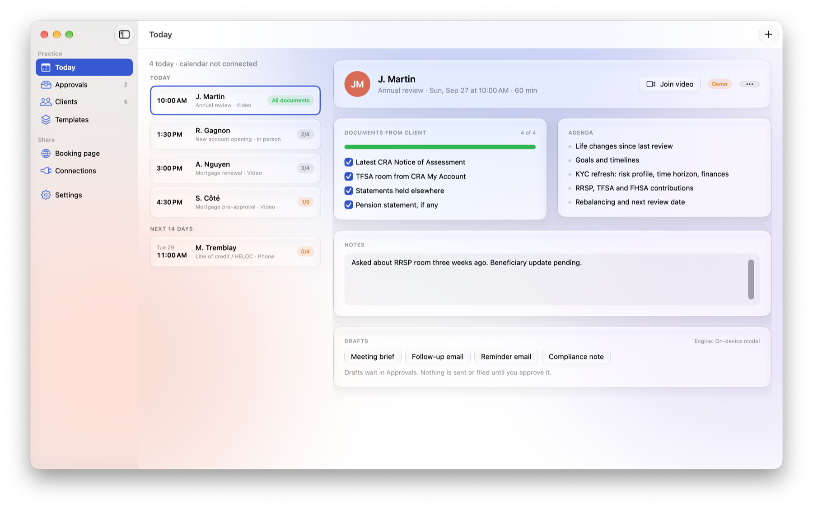
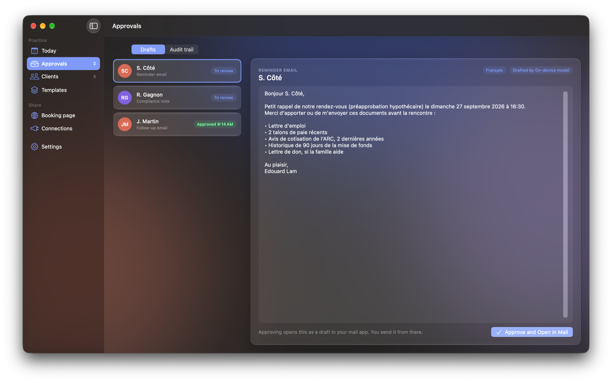
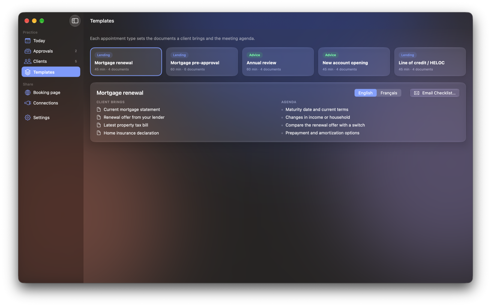
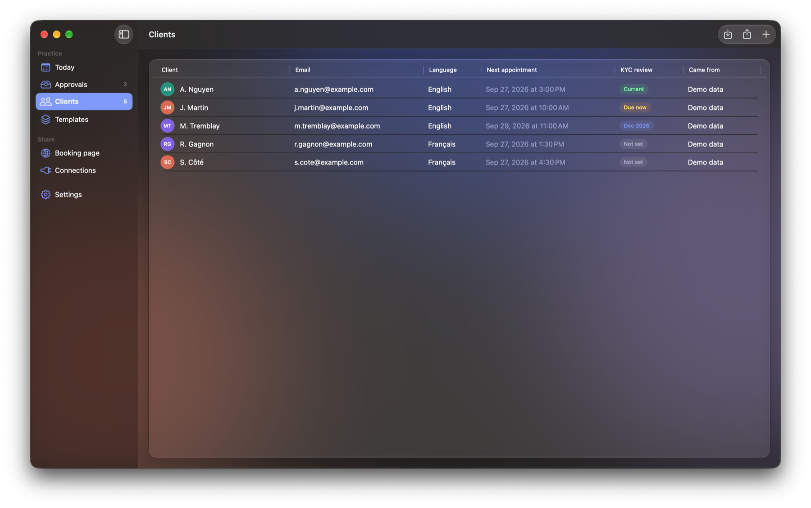
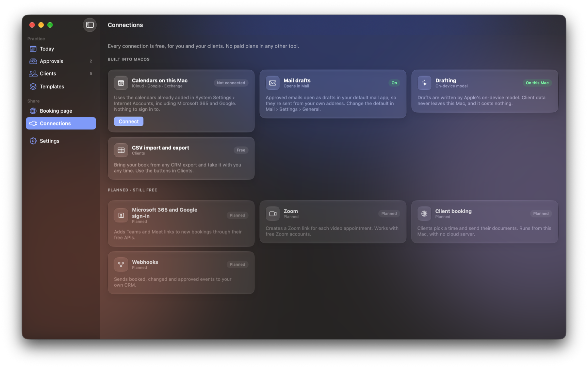
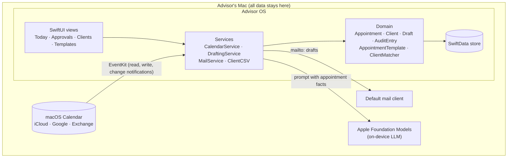

<div align="center">


# Advisor OS

**A local-first macOS workspace for Canadian financial advice and lending appointments.**

[](#building-from-source)
[](https://www.swift.org)
[](https://developer.apple.com/xcode/swiftui/)
[](#privacy-and-regulatory-context)
[](LICENSE)

</div>

<picture>
  <source media="(prefers-color-scheme: dark)" srcset="docs/images/today-dark.png">
  
</picture>

## Abstract

Retail financial advisors and mortgage agents spend a large share of their week on work that surrounds a meeting rather than the meeting itself: collecting documents, preparing briefs, writing follow-ups and documenting files for compliance. **Advisor OS** treats the *appointment* as the unit of work and organizes that surrounding work around it. It reads the calendars already configured on the Mac, attaches a Canadian document checklist and agenda to each appointment, drafts client communications and file notes with Apple's on-device language model, and requires explicit human approval, recorded in an audit trail, before anything is used.

The system is **local-first by construction**. All records live on the advisor's Mac, language generation runs on-device, and every integration uses facilities macOS already provides. There's no server, no cloud database and no paid third-party service. This makes the tool usable in regulated settings where sending client data to an external service is either prohibited or requires lengthy review.

## Contents

- [Motivation](#motivation)
- [Design principles](#design-principles)
- [What it does](#what-it-does)
- [Architecture](#architecture)
- [Key technical decisions](#key-technical-decisions)
- [Privacy and regulatory context](#privacy-and-regulatory-context)
- [Evaluation](#evaluation)
- [Building from source](#building-from-source)
- [Limitations and future work](#limitations-and-future-work)
- [Author](#author)

## Motivation

An advisor's calendar says *who* and *when*, but not *what is needed*. Before a mortgage pre-approval, the client must bring employment letters, pay stubs, two years of CRA Notices of Assessment and 90 days of down-payment history. Before an annual review, the advisor must refresh the client's KYC profile and confirm registered-account contribution room. That knowledge usually lives in the advisor's head or in scattered checklists, and meetings regularly start with missing documents.

Existing tools tend to fall into two camps. Enterprise CRMs are powerful but expensive and IT-controlled. Consumer schedulers solve booking but know nothing about the domain. Both typically move client data into third-party clouds. Advisor OS explores a third option: a **domain-aware layer over the tools the advisor already has**, which adds structure without taking custody of the data.

Based on the author's front-line experience at two of Canada's largest banks, the working hypothesis is that about 60% of pre- and post-meeting administration can be drafted automatically and reviewed by the advisor. That would reduce roughly 10 hours of weekly administration to about 4. This is an estimate to be tested, not a measured result.

## Design principles

1. **The appointment is the unit of work.** Checklists, drafts, notes and audit entries all attach to an appointment rather than floating free.
2. **Local-first, no exceptions.** Data, inference and integrations stay on the device. The tool must work with the network cable unplugged.
3. **Human in the loop.** The model drafts; the advisor decides. Nothing is sent, filed or used without an explicit, logged approval.
4. **Zero-cost integration.** Every integration relies on capabilities macOS already provides (EventKit, the default mail client, the file system), so adopting the tool never requires another subscription or an IT integration project.
5. **Bilingual by default.** Client-facing material follows each client's language (English or Canadian French). Internal documents stay in the advisor's working language.
6. **Degrade gracefully.** Every AI feature has a deterministic fallback, so the tool stays fully functional on Macs without Apple Intelligence.

## What it does

| | |
|---|---|
|  | **Drafting and approvals.** Meeting briefs, follow-ups, reminders and compliance notes are generated on-device from the appointment's facts. The example is a reminder written in Canadian French for a French-speaking client. Each draft waits in an approval queue; approving an email opens it in the advisor's own mail client, and every action is appended to an audit trail. |
|  | **Canadian appointment templates.** Mortgage renewal, mortgage pre-approval, annual review, account opening and HELOC. Each defines the documents a client must bring (CRA Notices of Assessment, FHSA and TFSA room, 90-day down-payment history, and so on) and a meeting agenda, in English and French. Checklists can be emailed to clients directly. |
|  | **Client records.** Appointments are linked to clients by identity resolution (email first, then exact name), which gives each client a language preference and a KYC review date. Records import from and export to CSV using the column conventions of common CRM exports. |
|  | **Integrations without accounts.** Calendars (iCloud, Google, Microsoft Exchange / 365) are read through EventKit from the accounts already on the Mac, with per-calendar work/personal selection and live updates. Video links from Teams, Zoom and Meet are detected in event data. |

A menu bar extra shows the next appointment and any outstanding documents without opening the main window.

## Architecture



| Layer | Responsibility |
|---|---|
| `Models/` | SwiftData entities, the Canadian template catalogue, event-title parsing and client identity resolution. Pure and unit-tested. |
| `Services/` | Boundaries to the operating system: EventKit sync, on-device generation with a deterministic fallback, mail drafts, CSV. |
| `Views/` | SwiftUI screens. They hold no business rules beyond presentation. |
| `Design/` | A small token system adapted from the DesignCode UI kit and rendered with native Liquid Glass materials. |

## Key technical decisions

**EventKit instead of calendar APIs.** Microsoft Graph and the Google Calendar API would require OAuth apps, consent screens, token storage and, at many institutions, IT approval. Reading through EventKit reuses the accounts the advisor has already added to macOS, covers all three major providers with one code path, needs no credentials in the app, and delivers change notifications (`EKEventStoreChanged`) so appointments reflect edits made elsewhere without polling.

**On-device generation with a deterministic fallback.** Drafts come from Apple's Foundation Models framework, so client data never leaves the machine and the marginal cost is zero. The model is constrained by instructions to use only the facts provided, to mark unknowns as *to be confirmed*, and never to recommend products or promise rates. When the model is unavailable (Apple Intelligence disabled, an ineligible device, or the model still downloading), `DraftingService` falls back to parameterized templates with the same structure. Behaviour is therefore identical in kind across all supported Macs.

**Language as a property of the relationship.** A draft's language is derived from the linked client, but only for client-facing kinds (follow-ups and reminders). Briefs and compliance notes remain in English for the advisor's file. Document names are localized by index from the template catalogue, so the French checklist always corresponds item-for-item to the English one. A test enforces this invariant.

**Conservative identity resolution.** Appointments imported from a calendar carry only a free-text title. `ClientMatcher` links them to client records by email first, then by exact normalized name, and deliberately does *not* fuzzy-match. "J. Martin" and "Julie Martin" stay separate until the advisor links them, because a false merge between two clients' files is worse than a missing link.

**Idempotent synchronization.** Calendar sync is keyed by event identifier. It updates appointments in place, which preserves document check-offs and notes. It removes appointments whose events were deleted or whose calendars are no longer marked as work. Disconnecting removes all imported appointments while leaving the calendars themselves untouched.

**Stable local code signing.** A self-signed signing identity (`scripts/make-signing-cert.sh`) gives every build the same designated requirement, so macOS privacy permissions persist across rebuilds without an Apple Developer account. Release builds use the Hardened Runtime.

## Privacy and regulatory context

Advisor OS is designed with the Canadian regulatory environment in mind. It is **not** a compliance product, and using it does not by itself satisfy any obligation.

| Framework | How the design responds |
|---|---|
| **PIPEDA** and **Québec Law 25** | No personal information leaves the device. There's no processor, no cross-border transfer and no third-party disclosure to assess. |
| **CIRO / CSA Client Focused Reforms** (KYC) | Clients carry a KYC review date. Annual-review templates include a KYC refresh, and overdue reviews are flagged. |
| **FINTRAC** (identity verification) | Account-opening templates prompt the advisor to verify identity by an accepted method and record it, without storing copies of identity documents. |
| **CASL** | The app sends nothing on its own. Emails open as drafts in the advisor's own client and are sent by the advisor. |
| **Record-keeping** | Every draft, edit, approval and synchronization is appended to an audit trail with a timestamp and actor. |

## Evaluation

The test suite (Swift Testing, `make test`) has **13 tests in 5 suites**, including parameterized cases:

- **Template inference:** event titles in English and French map to the correct appointment type, and client names are extracted from common title conventions.
- **Localization invariant:** every template's French checklist corresponds item-for-item to the English one.
- **Identity resolution:** email takes precedence over name, names match exactly after normalization, and near-duplicates are not merged.
- **Language routing:** a French-speaking client receives French reminders with localized document names, while compliance notes for the same appointment stay in English.
- **CSV interoperability:** quoted fields, escaped quotes, embedded newlines, Windows line endings and common CRM header variants.
- **Live model test:** on Macs with Apple Intelligence enabled, a meeting brief is generated by the on-device model and checked for substance. The test is skipped automatically elsewhere.

## Building from source

**Requirements:** macOS 26 or later, Xcode 26, and [XcodeGen](https://github.com/yonaskolb/XcodeGen). On-device drafting needs Apple silicon with Apple Intelligence enabled; otherwise the template fallback is used.

```sh
brew install xcodegen
git clone https://github.com/eddylam2024/advisor-os.git
cd advisor-os
make run     # creates the local signing identity, generates the project, builds and opens the app
make test    # runs the test suite
make dmg     # builds dist/AdvisorOS-<version>.dmg
```

The `.dmg` is signed but not notarized. On first launch, macOS will ask you to approve it once under **System Settings › Privacy & Security › Open Anyway**.

The app opens with fictional demo data, which can be removed in Settings. Calendar access is requested only when you choose **Connect**.

## Limitations and future work

This is a working research prototype, not production software. Known limitations:

- **Self-service booking.** Clients can't yet book on their own. The planned approach keeps the local-first constraint: the app emails a client their open time slots as one-click links, and the client's reply is confirmed in the app. No server is involved.
- **Document storage.** Documents are tracked as checklist items. Files are not yet attached or stored.
- **Security at rest.** The app relies on FileVault. An in-app lock (Touch ID) and encrypted export or backup are planned.
- **Editing.** Appointment times and client records can't yet be edited after creation, and templates are fixed in code rather than editable by firms.
- **Localization.** Client-facing drafts and checklists are bilingual; the interface itself is English only.
- **Evaluation.** The time-saving hypothesis has not yet been measured with practicing advisors. A small pilot measuring pre-meeting document completeness and time to follow-up is the natural next step.

## Author

**Edouard Lam** designed and built Advisor OS. It sits where banking and software meet: front-line experience with clients and regulated products at two of Canada's Big Five banks, combined with building the automation and AI systems that remove friction from that work.

- Website: [edouardlam.com](https://edouardlam.com)
- Based in Montréal · open to conversations about fintech, automation and applied AI

If you use or reference this work, please cite it using [`CITATION.cff`](CITATION.cff).

## Acknowledgements

The visual language is adapted from the community [DesignCode UI kit](https://www.figma.com/community) for Figma and implemented with Apple's native materials.

## License and disclaimer

Released under the [MIT License](LICENSE). © 2026 Edouard Lam.

Advisor OS is a personal project shared for educational and portfolio purposes. It is not financial advice, and it is not affiliated with, endorsed by, or part of the author's work at any employer. All names and data shown are fictional.
